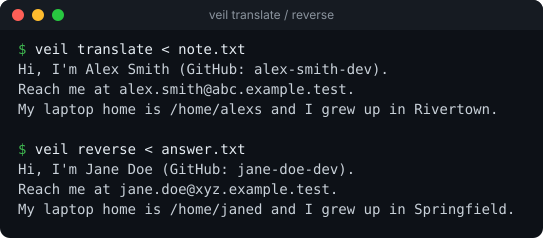
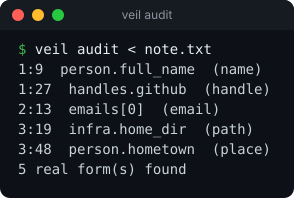

# Project Veil

Keep your personal information out of AI chats and coding agents by **translating it into a
consistent fake persona** before text leaves your machine, and translating the answers back.

"Jane" always becomes "Alex", her university becomes another university, and her username,
email, home path and roll number all become matching fakes. The AI still gives useful answers
about "Alex"; you get them back with your real details restored.

> **Status: v0.1.0 in progress.** The encrypted persona, the translation engine, the clipboard
> hotkeys and "veil ON" (every copy sanitized automatically) work on KDE Plasma 6 / Wayland.
> Still to come before the release: testing on the chat sites themselves (milestone M4).
> **macOS:** sanitize, restore, sanitize-then-paste (`Cmd+V`), `veil ON`, exported `.shortcut`
> workflows and a menu-bar status item (`veil menubar`), through the Keychain, the pasteboard and
> launchd ([`docs/macos.md`](docs/macos.md)).
> **Getting started:** [`docs/humans/GETTING-STARTED.md`](docs/humans/GETTING-STARTED.md) ·
> [Architecture & docs](docs/humans/README.md) · [Roadmap](ROADMAP.md).

<p align="center">
  <br>
  
</p>

The persona in these screenshots is the synthetic one from the test suite.

## Planned releases
| Release | What |
|---|---|
| **v0.1.0** | Web chats (claude.ai, ChatGPT, Gemini, any site): a clipboard hotkey sanitizes text before you paste; another restores real details in a copied answer. Plus a `veil` CLI (`veil translate`, `veil reverse`) |
| v0.2.0 | A local proxy for Claude Code: translates every request, including file contents and tool output, and reverse-translates the agent's tool calls so it keeps working on your real files |
| Later | Detection of unknown names, a browser extension, other agents |

## How it works (in short)
- **Your persona** (real ↔ fake mapping) is stored **encrypted** on your machine (age encryption,
  key in your desktop keyring: KDE Wallet or another Secret Service on Linux, the login Keychain on
  macOS) and is never sent anywhere.
- Every real form maps to exactly one fake form (a strict one-to-one mapping), so translation
  is reversible.
- Matching is Unicode-aware: case-insensitive, robust to invisible characters and full-width
  letters, and handles Indic scripts and Hangul correctly, including decomposed (NFD) text as
  macOS produces it (names inside longer words are not matched).
- Failures are **fail-closed**: on any error veil blocks or clears rather than sending real data.

## Platform support

Veil is built and tested first on **Linux, KDE Plasma 6 on Wayland** (Fedora). macOS runs the
same code with small platform backends ([`docs/macos.md`](docs/macos.md)).

**Requirements on Linux:**
- Linux with systemd: veil keeps temporary plaintext only in your login session's in-memory
  runtime directory (`/run/user/<uid>`, tmpfs) and refuses to run edits anywhere else.
- A Secret Service keyring (KDE Wallet, GNOME Keyring or KeePassXC) to hold the encryption key,
  **or** passphrase mode (no keyring needed; works over ssh, but cannot be used from hotkeys yet).
- [uv](https://docs.astral.sh/uv/) (installs Python 3.13 for you).
- For the v0.1 clipboard hotkeys and "veil ON": KDE Plasma 6 on a Wayland session, `wl-clipboard`, `notify-send` (libnotify) and a systemd user session (it runs the copy watcher while veil is ON).

**Requirements on macOS:** uv. The Keychain, the pasteboard, notifications and the RAM disk for
`persona edit` come with macOS; nothing else to install.

| Platform | Persona, encryption, CLI (`veil translate`) | Clipboard hotkeys (v0.1) | Claude Code proxy (v0.2) |
|---|---|---|---|
| **Linux, KDE Plasma 6, Wayland** | ✅ target, tested | ✅ target (shortcuts installed by `veil install-shortcuts`) | ✅ target |
| Linux, GNOME, Wayland | 🟡 should work (GNOME Keyring is a Secret Service); untested | ❓ untested: GNOME may not let background tools read the clipboard; shortcuts must be added by hand | 🟡 should work; untested |
| Linux, other Wayland desktops (Sway, Hyprland…) | 🟡 should work with a Secret Service keyring or passphrase mode | 🟡 likely (they support `wl-clipboard`); shortcuts by hand | 🟡 should work |
| Linux, X11 session | 🟡 core should work | ❌ not supported (needs `xclip`/`xsel` support) | 🟡 should work |
| Linux without systemd / no `/run/user` tmpfs | ❌ `persona edit` refuses (no safe place for plaintext) | ❌ | ❌ |
| macOS (tested on 27, Apple silicon) | ✅ tested (key in the login Keychain, plaintext on a RAM disk) | ✅ sanitize, restore, sanitize-then-paste (`Cmd+V`), `veil ON`, exported `.shortcut` workflows (`veil install-shortcuts --open`), menu-bar toggle (`veil menubar`) | 🟡 should work (no platform-specific parts); untested |
| Windows | ❌ not supported yet (uses Unix-only file locking and permissions) | ❌ | ❌ |
| WSL | ❌ untested; no desktop keyring by default | ❌ | ❌ |

✅ supported and tested · 🟡 expected to work, untested · ❓ unknown · ❌ not supported

The platform-specific parts (file safety, keyring, clipboard, hotkeys) are small modules behind
shared interfaces; the macOS backends sit next to the Linux ones and are picked at run time.

## Limits
Veil **reduces** what you reveal; it does **not** make you anonymous. Your AI account already
identifies you to the provider, unique content (your actual code or research) can identify you,
and PDFs are passed through unchanged for now. Images: veil strips their metadata (EXIF, GPS,
XMP, PNG text chunks) but does not read text inside them.

**Clipboard history (KDE Klipper):** after you sanitize, veil removes your *original* text from
Klipper's history. Klipper has no "remove one entry" call, so veil rebuilds the history without it:
your other text entries are kept, but image entries drop out of the history. If that fails, the
notification warns you. Other clipboard managers are not handled, and when a sanitize is denied or
fails, the original stays in the history. On macOS, clipboard managers that honour the
[nspasteboard.org](http://nspasteboard.org) markers skip veil's writes.

**macOS copy watcher:** a paste within 0.25 s of a copy can still carry the original
([details](docs/macos.md#the-copy-watcher)).

## Development
Requires [uv](https://docs.astral.sh/uv/) (it installs Python 3.13 for you).

```bash
uv sync                     # create the environment
uv run veil --version
uv run pytest -q            # unit + property tests
uv run ruff check . && uv run ruff format --check .
```

CI runs the same checks on Linux and macOS on every push and pull request
(`.github/workflows/ci.yml`). Faster local runs: `uv run python -m pytest --testmon -q` (only the
tests a change touches) and `-n auto` (parallel).
To contribute, read [CONTRIBUTING.md](CONTRIBUTING.md) first: signed-off commits (DCO), pull
requests into `main`.

## Privacy rules for contributors
- Never commit real personal data: not in code, tests, fixtures, logs or commit messages. Tests
  use a synthetic persona (Jane Doe → Alex Smith).
- Your real persona file (`persona.yaml`) is git-ignored; `persona.example.yaml` is the blank
  template.
- Use your GitHub noreply address as your git commit email.

## Current maintainers
- Claude (Mastermind + Orchestrator)
- Me (Dumb Human)

## License
GNU General Public License v3.0 ([LICENSE](LICENSE)), with one additional term under its section 7(b): keep the attribution "Based on Project Veil by Aryanil Panja" and the copyright notices ([NOTICE](NOTICE)).
