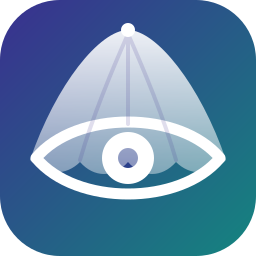
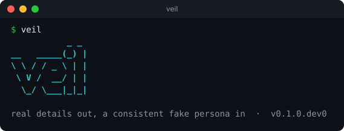

<p align="center"></p>

# veil-macos

Keep your personal information out of AI chats and coding agents: veil **translates it into a
consistent fake persona** before text leaves your machine, and translates the answers back.

"Jane" always becomes "Alex", her university becomes another university, and her username,
email, home path and roll number all become matching fakes. The AI still gives useful answers
about "Alex"; you get them back with your real details restored.

> **Getting started:** [`docs/humans/GETTING-STARTED.md`](docs/humans/GETTING-STARTED.md).
> How it works, architecture and operations: [`docs/humans/`](docs/humans/README.md).
> What's planned and what you can pick up: [`ROADMAP.md`](ROADMAP.md).

veil-macos is a fork of [Project Veil](https://github.com/AryanilPanja/Project-Veil) by
Aryanil Panja. It adds macOS support and `veil agent-guard`, and keeps Linux working from the
same code.

<p align="center">
  <br>
  
</p>

The persona in these screenshots is the synthetic one from the test suite. `veil` on its own
shows the help under this banner:

<p align="center"></p>

## Quick start

```bash
uv tool install git+https://github.com/VA24d/veil-macos   # or: git clone, then uv sync
veil persona import persona.yaml   # validate and encrypt; start from persona.example.yaml
veil install-shortcuts             # KDE: installs the hotkeys. macOS: prints the steps
veil on                            # every copy is sanitized until `veil off`
```

Text in a terminal or a script:

```bash
veil translate < notes.txt > notes.fake.txt     # real -> fake
veil reverse < answer.txt                       # fake -> real (for you, never for an agent)
veil audit < draft.txt                          # where real details are, by field path
```

## How it works

- **Your persona** (the real-to-fake mapping) is stored **encrypted** on your machine with
  age. The key is kept in your keyring: KDE Wallet or another Secret Service on Linux, the login
  Keychain on macOS. Nothing is sent anywhere.
- Every real form maps to exactly one fake form, so translation is reversible.
- Matching is Unicode-aware: case-insensitive, and not fooled by invisible characters, full-width
  letters and decomposed (NFD) text, and correct for Indic scripts and Hangul. A name inside a
  longer word is not matched.
- **Fail closed**: on any error veil clears or blocks the clipboard instead of sending real
  text.
- Sensitive terms you list (a health condition, for example) can be generalized ("a chronic
  condition") or trigger an Allow / Generalize / Deny prompt before they are sent.

## Platforms

| Platform | Persona, CLI | Clipboard hotkeys, veil ON | Notes |
|---|---|---|---|
| **Linux, KDE Plasma 6, Wayland** | ✅ tested | ✅ tested | the upstream target |
| **macOS** (tested on 27, Apple silicon) | ✅ tested | ✅ sanitize, restore, ON/OFF | no sanitize-then-paste yet; [docs/macos.md](docs/macos.md) |
| Linux, GNOME or other Wayland desktops | 🟡 should work | 🟡 hotkeys by hand | untested |
| Linux, X11 | 🟡 core should work | ❌ | needs `xclip`/`xsel` support |
| Linux without systemd or `/run/user` tmpfs | ❌ `persona edit` refuses | ❌ | no safe place for plaintext |
| Windows, WSL | ❌ | ❌ | not ported |

✅ tested · 🟡 expected to work, untested · ❌ not supported

Requirements:

- [uv](https://docs.astral.sh/uv/) (installs Python 3.13).
- Linux: systemd, a Secret Service keyring (or passphrase mode), and for the hotkeys
  `wl-clipboard` and `notify-send`.
- macOS: nothing else.

## Coding agents: `veil agent-guard`

```bash
veil agent-guard install    # in a project you open with Claude Code
```

- Blocks agents from veil's key, persona, clipboard tools and kill switch, and runs their
  shell commands in the OS sandbox.
- Reviews each edit and the session's diff for removed or skipped tests, weakened asserts,
  edited expected outputs, changed evaluation or metric code, and destructive git commands,
  and flags them before the agent can call the task done.
- Tells the agent that veil is active, so it keeps fake names as they are and doesn't ask for
  real ones.

Details and the incidents it is based on: [docs/agent-guard.md](docs/agent-guard.md).

## Limits

- veil **reduces** what you reveal; it does not make you anonymous. Your AI account already
  identifies you to the provider, and unique content (your code, your research) can identify
  you.
- Images, PDFs and rich text pass through unchanged.
- KDE Klipper: after a sanitize, veil rebuilds Klipper's history without your original text.
  Klipper can't remove one entry, so image entries drop out of the history. Other clipboard
  managers are not handled on Linux; on macOS, managers that honour the nspasteboard.org
  markers skip veil's writes.
- macOS: a paste within 0.25 s of a copy can still carry the original
  ([details](docs/macos.md#the-copy-watcher)).

## Development

```bash
uv sync
uv run ruff check . && uv run ruff format --check .
uv run python -m pytest --testmon -q                 # tests your change touches
uv run python -m pytest --testmon-noselect -n auto   # the full suite, in parallel
```

CI runs lint and the full suite on Linux and macOS for every push and pull request. See
[CONTRIBUTING.md](CONTRIBUTING.md), [SECURITY.md](SECURITY.md),
[docs/release.md](docs/release.md) and [CHANGELOG.md](CHANGELOG.md).

Never commit real personal data. Tests use the synthetic persona Jane Doe → Alex Smith.

## License and attribution

GPL-3.0-only; see [LICENSE](LICENSE) and [NOTICE](NOTICE).

- Project Veil: Copyright (C) 2026 Aryanil Panja. The macOS port: Copyright (C) 2026 the
  veil-macos contributors.
- Under GPL-3.0 section 7(b), every copy and derivative must keep the line "Based on Project
  Veil by Aryanil Panja (https://github.com/AryanilPanja/Project-Veil)." in its NOTICE, its
  About or documentation, and its `--version` output. A modified version must say it is
  modified (section 7(c)).
- Derivatives must stay open source under the same license.
